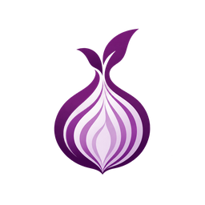

 <div align="center">



# The Onion Programming Language

**Built layer by layer.**

*A Rust-inspired, independently developed programming language focused on simplicity, performance, security, and developer experience.*

**Experimental · Written in Rust · Version 0.1.0**

[Getting Started](#getting-started) · [Language Features](#language-features) · [Compiler & Tooling](#compiler--tooling) · [Roadmap](#development-roadmap) · [Contributing](#contributing)

</div>

---

## Introduction

**Onion** is an experimental programming language built from the ground up in Rust.

The project aims to combine familiar, readable syntax with native compilation, useful developer tooling, and a security-conscious approach to language design.

Onion is being developed as an independent language rather than an extension or fork of Rust. Its syntax takes inspiration from Rust, but its compiler, language features, and future development direction are its own.

The repository includes a compiler, interpreter, native compilation backend, language-server infrastructure, Visual Studio Code integration, automated tests, and experimental UI development.

> **Development status:** Onion is in active early development. Its syntax, APIs, and internal architecture may change. It is not yet recommended for production use.

## Why Onion?

Onion is guided by five design principles.

**Familiarity.** Provide recognizable syntax for functions, variables, types, expressions, and control flow without requiring developers to learn an entirely unfamiliar programming model.

**Simplicity.** Prioritize readable code, understandable language rules, and clear compiler diagnostics.

**Performance.** Develop a native compilation pipeline using Cranelift while retaining an interpreter for development and experimentation.

**Security.** Introduce ownership, borrowing, static analysis, and safer APIs through incremental, test-driven implementation.

**Developer Experience.** Maintain a cohesive ecosystem with a compiler, command-line interface, language server, editor extension, documentation, and development tools.

Onion does not currently provide the complete ownership model, borrow checker, memory-safety guarantees, or feature compatibility of Rust.

---

## Getting Started

Onion supports the `.onion` and `.oni` file extensions.

Create a file named `main.onion`:

```rust
fn main() {
    println!("Hello, Onion!");
}
```

Run it using the Onion CLI:

```powershell
onion run main.onion
```

Expected output:

```text
Hello, Onion!
```

### Building from Source

Until official prebuilt releases are available, Onion can be built from source.

Requirements:

- Rust and Cargo
- A supported Rust build toolchain
- Windows development environment (the primary development platform)

Clone the repository:

```powershell
git clone https://github.com/RivalAkmallll/onion.git
cd onion-lang
```

Build the compiler:

```powershell
cd onion-compiler
cargo build --release
```

Run compiler tests:

```powershell
cargo test
```

The compiled executable can be found in the appropriate Cargo target directory.

For local development, commands can also be run through Cargo:

```powershell
cargo run -- run ..\hello-onion\main.onion
```

Adjust the source path to match the example file available in your checkout.

### Command-Line Interface

The current Onion CLI provides the following core commands:

| Command | Purpose |
|---|---|
| `onion run <file>` | Execute an Onion program |
| `onion build <file>` | Build an Onion program |
| `onion check <file>` | Check an Onion program for errors |
| `onion --version` | Show the compiler version |

Command behavior and supported options may evolve as the compiler develops.

---

## Language Features

Onion currently supports a growing subset of general-purpose programming constructs.

### Variables and Basic Types

```rust
fn main() {
    let name = "Onion";
    let mut counter = 10;
    let pi = 3.14;
    let active = true;

    counter += 5;

    println!("Language: {}", name);
    println!("Counter: {}", counter);
    println!("Pi: {}", pi);
    println!("Active: {}", active);
}
```

Current primitive types include:

- `i32` — 32-bit signed integers
- `f64` — 64-bit floating-point numbers
- `bool` — Boolean values
- `String` — String values

The type system is under active development.

### Control Flow

Onion supports conditional statements, loops, and loop-control statements.

```rust
fn main() {
    let mut counter = 0;

    loop {
        counter += 1;

        if counter % 2 == 0 {
            continue;
        }

        println!("counter = {}", counter);

        if counter >= 9 {
            break;
        }
    }

    println!("Finished!");
}
```

### Optional Semicolons

Onion supports optional semicolons in its current statement syntax.

Both forms are valid:

```rust
fn main() {
    let x = 10
    let y = 20

    println!("{}", x + y)
}
```

```rust
fn main() {
    let x = 10;
    let y = 20;

    println!("{}", x + y);
}
```

### Ownership Foundations

Onion includes an initial ownership-checking implementation for `String` values.

For example, a `String` binding can be moved into another variable:

```rust
fn main() {
    let message = "Hello, Onion!";
    let moved = message;

    println!("{}", moved);
}
```

Using the original binding after the move is rejected by the ownership checker.

```rust
fn main() {
    let message = "Hello, Onion!";
    let moved = message;

    println!("{}", message);
}
```

The ownership model is currently limited and is not equivalent to Rust's ownership system.

### Reference Syntax — Experimental

Onion's parser has begun supporting reference-related syntax:

```rust
let view = &message;
let reference = &mut score;
```

Dereference expressions are also part of the experimental syntax foundation.

**These constructs are not yet complete runtime features.** Reference typing, borrow validation, lifetime analysis, and full execution support are being developed in subsequent phases.

---

## Compiler & Tooling

Onion's compiler is implemented in Rust and is organized into several components.

| Component | Description | Status |
|---|---|---|
| Lexer | Tokenizes Onion source code | Implemented |
| Parser | Produces the language's abstract syntax tree | Implemented, expanding |
| Type Checker | Checks types, bindings, and language rules | Implemented, expanding |
| Ownership Checker | Detects supported String move violations | Initial implementation |
| Interpreter | Executes supported Onion programs | Implemented |
| Native Backend | Compiles supported programs using Cranelift | Experimental |
| Security Analyzer | Performs initial source-level security checks | Experimental |
| Onion CLI | Provides run, build, and check commands | Implemented |
| Onion LSP | Language-server infrastructure | In development |
| VS Code Extension | Editor integration for Onion files | In development |
| Borrow Checker | Enforces reference and borrowing rules | Planned / in progress |

### Native Compilation

Onion includes an experimental native compilation backend built around **Cranelift**.

The long-term goal is to provide efficient native executables while preserving a development-friendly compiler workflow.

Native compilation is not yet feature-complete, and support may differ from the interpreter for newly introduced language constructs.

### Diagnostics and Static Analysis

The compiler includes checks for:

- Type mismatches
- Undefined variables
- Invalid assignments
- Invalid control-flow usage
- Supported ownership violations
- Selected arithmetic and security-related issues

The security analyzer is an early implementation, not a complete vulnerability scanner or security audit.

---

## Developer Experience

### Visual Studio Code

The repository includes an Onion extension for Visual Studio Code.

Its development goals include:

- Syntax highlighting
- Onion file recognition
- Compiler diagnostics
- Language Server Protocol integration
- Code completion
- Editor assistance and navigation

The extension is still being prepared for broader distribution.

A future release is planned for the Visual Studio Code Marketplace.

### Modern UI Development — Experimental

Onion also contains an experimental user-interface laboratory based on Rust and Dioxus.

The experiment explores:

- Desktop application interfaces
- Reusable UI components
- Modern styling and layout
- Light and dark themes
- Interactive controls
- Future declarative UI concepts

The current UI laboratory is a **Rust-hosted prototype**, not an Onion-native UI library.

A future goal is to let developers create modern desktop and web interfaces directly from Onion programs.

---

## Security Philosophy

Security is an important direction for Onion's development.

Rather than claiming complete memory safety before the required compiler features exist, Onion is building its safety mechanisms incrementally.

### Planned Security Capabilities

**Memory and Reference Safety**

- Ownership and move tracking
- Immutable borrowing
- Mutable borrowing
- Borrow-conflict detection
- Lifetime and scope validation
- Prevention of dangling references

**Static Analysis**

- Detection of common unsafe programming patterns
- Expanded arithmetic safety checks
- Security-focused compiler diagnostics
- Optional strict security checks

**Application Security**

- Secure networking APIs
- HTTPS and TLS support
- Safer defaults for public network applications
- Input-validation utilities
- Dependency vulnerability auditing

**Security Development Tools**

- Fuzz-testing support
- Security testing workflows
- Future integration with vulnerability-analysis tools
- Experimental AI-assisted code-security analysis

These capabilities are development goals unless explicitly marked as implemented.

Onion's objective is to make secure application development more approachable without overstating its current security guarantees.

---

## Testing

The project uses automated Rust tests and separate Onion-language test cases.

Run the Rust compiler tests:

```powershell
cd onion-compiler
cargo test
```

Check the compiler build:

```powershell
cargo build --bins
```

The repository also includes Phase 16 borrowing-related test programs and a PowerShell test runner:

```powershell
.\scripts\test-phase16.ps1
```

Run the script from the repository root.

Some borrowing tests are forward-looking specifications for functionality that is still under development. A negative test must reject a program for the intended semantic reason, not merely because its syntax is unsupported.

---

## Repository Structure

```text
onion/
├── onion-compiler/
│   ├── src/
│   │   ├── ast.rs
│   │   ├── lexer.rs
│   │   ├── parser.rs
│   │   ├── checker.rs
│   │   ├── interpreter.rs
│   │   ├── codegen.rs
│   │   └── ...
│   ├── vscode-onion/
│   ├── Cargo.toml
│   └── Cargo.lock
│
├── experiments/
│   └── onion-ui-lab/
│
├── tests/
│   └── phase16/
│
├── scripts/
│   └── test-phase16.ps1
│
├── hello-onion/
├── install.ps1
└── README.md
```

This diagram highlights major components rather than every source file or directory.

---

## Development Roadmap

Onion's development is organized into several ongoing tracks.

### Phase 1 — Language Foundations

- [x] Initial Rust compiler implementation
- [x] Lexer and parser
- [x] Abstract syntax tree
- [x] Primitive types
- [x] Variables and mutable bindings
- [x] Arithmetic and comparison operators
- [x] Conditional statements
- [x] Loops, break, and continue
- [x] Formatted output
- [x] Optional semicolons

### Phase 2 — Compiler and Developer Tooling

- [x] Onion command-line interface
- [x] Interpreter foundation
- [x] Experimental Cranelift native backend
- [x] Language Server Protocol foundation
- [x] VS Code extension foundation
- [x] Compiler unit tests
- [ ] Expanded language-server capabilities
- [ ] Improved diagnostics and error recovery
- [ ] More consistent interpreter/native-backend support
- [ ] Debugging infrastructure
- [ ] Broader cross-platform testing

### Phase 3 — Ownership and Memory Safety

- [x] Initial `String` move detection
- [x] Reference operator tokenization
- [x] Reference and dereference syntax parsing foundation
- [ ] Phase 16.5 — Immutable reference typing and execution
- [ ] Phase 16.6 — Mutable borrowing and exclusive access
- [ ] Borrow-conflict validation
- [ ] Move-while-borrowed prevention
- [ ] Lifetime and scope validation
- [ ] Dangling-reference prevention
- [ ] Native backend support for references
- [ ] Expanded ownership and memory-safety testing

### Phase 4 — Security Infrastructure

- [x] Initial experimental security scanner
- [ ] Expanded static vulnerability detection
- [ ] Security-focused compiler warnings
- [ ] Dependency auditing
- [ ] Fuzz-testing integration
- [ ] Secure standard-library APIs
- [ ] Input and data validation APIs
- [ ] Security testing and analysis tooling
- [ ] Experimental AI-assisted security analysis

### Phase 5 — Standard Library and Networking

- [ ] Standard-library foundation
- [ ] File-system and I/O APIs
- [ ] Collections and data structures
- [ ] Error-handling APIs
- [ ] HTTP client and server capabilities
- [ ] HTTPS/TLS integration
- [ ] Secure networking defaults
- [ ] JSON and serialization support
- [ ] Database connectivity
- [ ] Async programming and concurrency

### Phase 6 — Modern Application Development

- [x] Experimental Rust/Dioxus UI laboratory
- [ ] Onion-native UI architecture
- [ ] Declarative UI components
- [ ] Modern desktop application tooling
- [ ] Web application tooling
- [ ] Responsive layouts and theming
- [ ] Reusable component ecosystem
- [ ] Development preview and hot reload
- [ ] Full-stack development workflows

### Phase 7 — Ecosystem and Public Releases

- [ ] Official Onion website
- [ ] Complete language documentation
- [ ] Beginner tutorials
- [ ] Prebuilt Windows compiler releases
- [ ] Public Windows installer
- [ ] VS Code Marketplace publication
- [ ] Linux support
- [ ] macOS support
- [ ] Package manager and dependency management
- [ ] Online Onion playground
- [ ] Community contribution guidelines
- [ ] Stable language specification
- [ ] Production readiness evaluation

The roadmap represents intended development priorities, not guaranteed features or release dates.

---

## Future Vision

Onion aims to grow beyond an experimental compiler into a general-purpose language ecosystem.

The long-term vision includes native executables, secure networking, desktop applications, web development, an extensible standard library, and integrated developer tooling.

A central goal is to make it possible to build applications while relying on one cohesive language experience—from writing and checking source code to compiling, testing, and deploying software.

Reaching this goal will require further language design, compiler validation, ecosystem development, documentation, and extensive testing.

---

## Documentation

Official documentation is in development.

Planned topics include:

- Installing and configuring Onion
- Language syntax and data types
- Functions, expressions, and control flow
- Ownership and references
- Compiler commands
- Native compilation
- Security and error handling
- Standard-library APIs
- UI and web application development

Until official documentation is published, the repository source code, examples, and test cases serve as the primary development references.

---

## Website

An official Onion website is planned.

It is intended to provide compiler downloads, installation instructions, language documentation, tutorials, examples, and project updates.

**Official website: Coming soon.**

---

## Getting Help

If you encounter a bug or unexpected compiler behavior, open a GitHub issue.

Include the following information when possible:

- Onion compiler version
- Operating system
- A minimal program that reproduces the issue
- Command used to run or compile the program
- Expected behavior
- Actual output or error message

[Report an Issue](https://github.com/RivalAkmallll/onion-lang/issues)

---

## Contributing

Onion is an independent open-source language project, and contributions are welcome.

Areas where contributors can help include:

- Compiler development
- Language design
- Native code generation
- Type checking and ownership analysis
- Security analysis
- Language-server development
- Editor tooling
- Testing and debugging
- Documentation
- Standard-library development
- UI and application tooling

If you would like to contribute, fork the repository, create a feature branch, and submit a pull request.

For significant language or compiler changes, opening an issue to discuss the design first is recommended.

---

## License

Onion is distributed under the **GNU Affero General Public License v3.0 only (AGPL-3.0-only)**.

See the repository's `LICENSE` file for the complete licensing terms.

---

<div align="center">


**The Onion Programming Language**

*Built layer by layer.*

[GitHub](https://github.com/RivalAkmallll/onion-lang) · [Issues](https://github.com/RivalAkmallll/onion-lang/issues) · [Releases](https://github.com/RivalAkmallll/onion-lang/releases)

</div>
